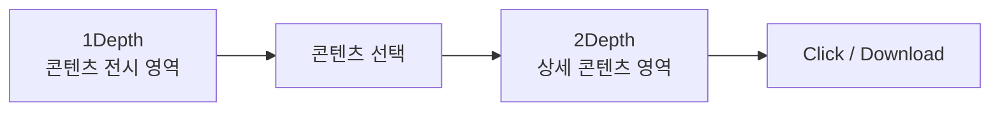
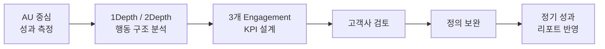

# Engagement KPI 설계 및 운영 지표화

> 단순 방문자 수로는 설명하기 어려운 사용자 참여 수준을 행동 로그 기반으로 정의하고,  
> **Full / 1Depth / 2Depth Engagement 지표를 설계하여 정기 성과 리포트에 반영한 프로젝트**

---

## 1. Project Overview

콘텐츠 전시 서비스는 사용자를 늘리고 반복적인 콘텐츠 탐색을 유도하는 것을 주요 목표로 운영되고 있었습니다.

초기에는 서비스 활성도를 측정하기 위해 Stickiness와 AU 활용을 검토했지만, 서비스 특성상 Stickiness를 지속적으로 활용하기 어려웠고 단순 AU만으로는 **사용자가 실제 콘텐츠에 관심을 보이고 의미 있는 행동까지 이어졌는지 판단하기 어려운 한계**가 있었습니다.

이에 단순 방문 여부가 아니라 **사용자가 어느 화면 단계까지 이동했고 어떤 행동을 수행했는지**를 기준으로 참여 수준을 측정하는 Engagement KPI를 설계했습니다.

| 항목 | 내용 |
|---|---|
| 분석 목적 | 사용자 행동 기반 Engagement KPI 설계 |
| 핵심 문제 | 단순 AU로는 실제 사용자 참여 수준 판단 한계 |
| 분석 기준 | 1Depth / 2Depth 행동 로그 |
| 핵심 행동 | Click / Download |
| 대표 KPI | Full Engagement |
| 세부 KPI | 1Depth Engagement / 2Depth Engagement |
| 확장 지표 | Full Engagement / Service AU |
| 집계 기준 | User × Date × Content → Weekly Unique User |
| 분석 도구 | SQL, Amazon Athena |
| 결과 | 고객사 협의 후 정기 성과 리포트 지표 반영 |

---

## 2. Problem & Design Approach

서비스 방문자 수인 AU는 전체 사용자 규모를 확인하기에는 유용하지만, **AU 증가가 곧 의미 있는 콘텐츠 참여 증가를 의미하지는 않습니다.**

```text
Service AU 증가
        ≠
실제 콘텐츠 참여 사용자 증가
```

같은 방문 사용자라도 서비스 내 행동 수준에는 차이가 있습니다.

```text
콘텐츠 노출
    ↓
콘텐츠 선택
    ↓
상세 콘텐츠 탐색
    ↓
Click / Download
```

따라서 지표 설계의 기준을 **“얼마나 많은 사용자가 방문했는가”**에서 **“서비스 안에서 의미 있는 행동을 수행한 사용자가 얼마나 되는가”**로 확장했습니다.

서비스 구조는 크게 1Depth와 2Depth로 구분했습니다.



- **1Depth**: 사용자가 콘텐츠를 처음 탐색하는 전시 영역
- **2Depth**: 콘텐츠 선택 후 진입하는 상세 콘텐츠 영역
- **Light Action**: Impression / Enter
- **Active Action**: Click / Download

초기에는 2Depth 진입 이후 Impression 또는 Enter가 발생한 사용자를 별도의 `Reader`로 구분하는 방안도 검토했습니다.

다만 단순 진입 로그만으로 실제 콘텐츠 열람 여부를 판단하기에는 한계가 있었기 때문에, 최종 Engagement KPI에서는 **사용자의 능동적인 행동이 명확하게 나타나는 Click과 Download를 핵심 기준**으로 설정했습니다.

---

## 3. Engagement KPI Definition

1Depth와 2Depth에서 발생한 행동 조합을 기준으로 사용자를 **세 가지 Engagement 지표**로 구분했습니다.

이 중 **Full Engagement를 서비스 전체의 대표 참여 KPI**로 설정하고, 1Depth / 2Depth Engagement를 통해 사용자의 참여 단계와 행동 경로를 추가로 확인했습니다.

| KPI | 행동 기준 | 의미 |
|---|---|---|
| **Full Engagement** | 1Depth 또는 2Depth에서 Click / Download | 하나 이상의 능동 행동을 수행한 전체 Engagement 사용자 |
| **1Depth Engagement** | 1Depth Download + 2Depth 행동 없음 | 상세 영역 진입 없이 1Depth에서 직접 전환한 사용자 |
| **2Depth Engagement** | 1Depth Click + 2Depth Click / Download | 2Depth까지 탐색한 뒤 추가 행동까지 수행한 사용자 |

### Full Engagement

서비스 내에서 하나 이상의 Active Action을 수행한 사용자

```text
1Depth Click / Download
        OR
2Depth Click / Download
```

단순 노출이나 상세 페이지 진입을 넘어 **실제 콘텐츠에 직접적인 반응을 보인 사용자 규모**를 확인하기 위한 대표 KPI입니다.

### 1Depth Engagement

2Depth로 이동하지 않고 1Depth에서 직접 Download까지 완료한 사용자

```text
1Depth Download
+
2Depth Action 없음
```

상세 콘텐츠 탐색 없이 전시 영역에서 바로 전환된 사용자 행동을 별도로 확인하기 위한 지표입니다.

### 2Depth Engagement

1Depth에서 콘텐츠를 선택하고 2Depth에서도 추가 Click 또는 Download까지 발생한 사용자

```text
1Depth Click
        ↓
2Depth 진입
        ↓
2Depth Click / Download
```

단순 2Depth 진입이 아니라 **서비스 퍼널을 따라 추가적인 능동 행동까지 이어진 사용자**를 측정합니다.

---

## 4. Aggregation Logic

Engagement KPI는 이벤트 발생 횟수가 아니라 **조건을 만족한 사용자 수**를 기준으로 설계했습니다.

동일 사용자가 같은 콘텐츠에서 여러 번 행동하더라도 반복 이벤트 자체가 KPI를 증가시키지 않도록, 사용자 행동을 먼저 통합한 뒤 Engagement 조건을 적용했습니다.

```text
Raw Event Log
        ↓
1Depth / 2Depth 구분
        ↓
User × Date × Content 단위 행동 집계
        ↓
1Depth / 2Depth Action 통합
        ↓
행동 조합 기반 Engagement Labeling
        ↓
Weekly Unique User 집계
```

SQL에서는 사용자별로 각 Depth에서 발생한 행동을 하나의 행동 집합으로 구성했습니다.

```sql
ARRAY_AGG(DISTINCT action)
FILTER (WHERE depth = '1Depth')

ARRAY_AGG(DISTINCT action)
FILTER (WHERE depth = '2Depth')
```

이후 행동 조합을 기준으로 세 가지 Engagement 조건을 적용했습니다.

```text
Full Engagement
→ 1Depth Active Action OR 2Depth Active Action

1Depth Engagement
→ 1Depth Download AND 2Depth Action 없음

2Depth Engagement
→ 1Depth Click AND 2Depth Active Action
```

최종 지표는 각 조건을 만족한 사용자를 주간 Unique User 기준으로 집계했습니다.

```sql
COUNT(DISTINCT engagement_user)
```

이를 통해 단순 이벤트량보다 **실제 Engagement 경험이 발생한 사용자 규모**를 지속적으로 확인할 수 있도록 구성했습니다.

---

## 5. Stakeholder Validation

초기 Engagement 지표와 샘플 결과를 산출한 이후 고객사 담당자와 지표 정의 및 활용 방향을 검토했습니다.

논의 과정에서는 세 가지 Engagement 지표의 정의뿐 아니라 **실제 정기 리포트에서 지속적으로 활용할 수 있는지**를 함께 확인했습니다.

### Full Engagement 중심 모니터링

전체적인 사용자 참여 수준을 대표하는 지표로 **Full Engagement를 중심으로 모니터링**하고, 1Depth / 2Depth Engagement를 통해 사용자가 어느 단계에서 적극적인 행동을 수행했는지 추가로 확인하는 구조로 정리했습니다.

```text
대표 KPI
Full Engagement

세부 Engagement
1Depth Engagement
2Depth Engagement
```

### Full Engagement 해석 보완

Full Engagement는 사용자 절대 수를 기준으로 관리했지만, 전체 서비스 AU의 증감에 따라 절대 사용자 수도 영향을 받을 수 있다는 의견이 있었습니다.

이에 대표 KPI의 해석을 보완하기 위한 확장 지표를 추가했습니다.

```text
Full Engagement Rate
=
Full Engagement User / Service AU
```

이를 통해 Full Engagement 사용자 규모를 중심으로 확인하면서, **전체 방문 사용자 중 Engagement 행동까지 발생한 사용자의 비중**도 함께 확인할 수 있도록 구성했습니다.

### KPI Definition Refinement

1Depth Engagement는 설계 과정에서 다음 두 기준을 비교했습니다.

```text
1Depth Download

vs.

1Depth Click + Download
```

Click까지 포함할 경우 Full Engagement와 정의가 중복될 가능성이 있었기 때문에, 지표별 역할을 구분할 수 있도록 조건을 검토했습니다.

최종 SQL에서는 **2Depth 행동이 없고 1Depth에서 Download가 발생한 사용자**를 1Depth Engagement로 분리했습니다.

---

## 6. Outcome

Engagement KPI 설계를 통해 기존의 단순 방문자 중심 성과 측정을 **행동 기반 사용자 참여 지표 체계**로 확장했습니다.



최종 운영 구조는 다음과 같습니다.

```text
대표 KPI
Full Engagement

세부 Engagement
1Depth Engagement
2Depth Engagement

확장 지표
Full Engagement / Service AU
```

설계한 Engagement 지표는 고객사와 정의 및 집계 방향을 협의한 뒤 **정기 성과 리포트에 반영**했으며, 이후 주간 모니터링과 세부 콘텐츠 단위 분석에도 동일한 로직을 활용했습니다.

이 프로젝트에서는 단순한 SQL 구현보다 **서비스 목표를 측정 가능한 사용자 행동으로 변환하고, 이를 세 가지 Engagement KPI로 구조화하여 실제 운영 지표로 연결한 과정**에 초점을 두었습니다.

---

## 7. Repository Information

### SQL

1Depth / 2Depth 행동 통합 및 Full / 1Depth / 2Depth Engagement User 분류 로직

### Metric Definition

세 가지 Engagement KPI의 행동 조건 및 집계 기준

### Sample Data

분석 로직 재현을 위해 공개용으로 생성한 합성 이벤트 로그 데이터

> 실제 회사 데이터, 고객사명, 내부 조직명, 사용자 식별자, 테이블명, 콘텐츠 ID 및 운영 관련 민감 정보는 포함하지 않습니다.

---

## Tech Stack

`SQL` `Amazon Athena` `Presto` `Event Log Analysis` `KPI Design` `User Segmentation` `Funnel Analysis`

---

[← Back to Data Analysis Portfolio](../)
