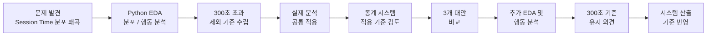

# 🚀 Session Time 이상치 제거 기준 수립 및 시스템 적용

> 2Depth 상세 콘텐츠의 Session Time 분포를 분석해 **300초 초과 로그 제외 기준을 수립**하고,  
> 이후 내부 통계 시스템 구축 과정에서 추가 조건을 재검증하여 **Session Time 산출 기준으로 반영한 프로젝트**

---

## 1. Project Overview

2Depth 상세 콘텐츠의 사용자 행동을 분석하는 과정에서, 일부 Session Time 로그가 비정상적으로 길게 발생하며 평균 및 최대값 등 주요 통계량을 왜곡하는 문제를 확인했습니다.

단순한 1회성 데이터 정제에 그치지 않고, **Python 기반 EDA를 통해 Session Time 분포와 Scroll Depth별 사용자 행동을 분석하여 `300초 초과 로그 제외` 기준을 수립**했습니다.

이후 해당 기준을 실제 Session Time 분석에 공통 적용했으며, 고객사 및 협력사가 사용하는 내부 통계 시스템 구축 과정에서 적용 기준에 대한 추가 검토 요청을 받아 Scroll Depth 조건과 1초 미만 로그 제외안까지 비교했습니다.

추가 EDA와 사용자 행동 특성을 검토한 결과, 복잡한 조건을 추가하기보다 **기존 300초 초과 제외 기준을 유지하는 것이 적절하다는 근거를 제시했고, 최종적으로 시스템의 Session Time 산출 기준에 반영되었습니다.**

- **분석 대상:** 2Depth 상세 콘텐츠 Session Time / Scroll Depth 로그
- **분석 기간:** 2025-02-05 ~ 2025-03-25
- **분석 도구:** Python, Pandas, Matplotlib, Seaborn
- **최종 기준:** `Session Time > 300초` 분석 대상 제외
- **Tech Stack:** `Data Quality` `Outlier Analysis` `User Behavior Analysis` `EDA`

---

## 2. Key Achievements

- **📈 Session Time 품질 기준 수립**
  - Scroll Depth 샘플 분석에서 약 **0.56%**에 해당하는 300초 초과 로그가 평균 및 최대값 등 주요 통계량을 왜곡할 수 있음을 확인하고, 반복 적용 가능한 이상치 제거 기준을 수립했습니다.

- **💡 사용자 행동 맥락을 반영한 이상치 판단**
  - Session Time 분포뿐 아니라 콘텐츠 유형과 Scroll Depth별 행동을 함께 분석했습니다.
  - 특히 1초 미만 Session을 단순 오류로 제거하지 않고, 실제 즉시 이탈 행동인지 확인한 뒤 제외 여부를 판단했습니다.

- **🤝 분석 기준의 시스템 적용**
  - 내부 통계 시스템 구축 과정에서 기존 300초 기준과 추가 대안을 비교 검토하고, 추가 EDA를 근거로 기존 기준 유지 의견을 제시했습니다.
  - 최종적으로 동일 기준이 실제 분석과 시스템 산출에 일관되게 적용될 수 있도록 연결했습니다.

---

## 3. Problem Definition & Domain Understanding

### Session Time Definition

Session Time은 서비스 전체 이용시간이 아니라, 사용자가 콘텐츠를 선택해 **2Depth 상세 콘텐츠 영역에 진입한 이후 해당 콘텐츠에서 머문 시간**을 의미합니다.

1Depth 전시 영역에서는 Session Time을 측정하지 않으며, 2Depth의 진입 이벤트와 이탈 이벤트 Timestamp 차이를 기준으로 산출합니다.

```text
1Depth 콘텐츠 전시
        ↓
콘텐츠 선택
        ↓
2Depth 상세 콘텐츠 진입
        ↓
콘텐츠 탐색
        ↓
2Depth 이탈

Session Time
= 이탈 Timestamp - 진입 Timestamp
```

원천 로그에서는 두 이벤트의 Timestamp 차이를 밀리초 단위로 계산하고, 분석에서는 이를 체류시간으로 변환해 활용했습니다.

따라서 이 프로젝트의 `300초`는 앱 전체 이용시간에 대한 기준이 아니라, **하나의 2Depth 상세 콘텐츠에서 5분을 초과해 체류한 Session에 대한 품질 기준**입니다.

### Why Outlier Handling?

Session Time은 사용자의 콘텐츠 소비 수준을 확인하는 데 유용하지만 극단값의 영향을 크게 받는 지표입니다.

```text
정상적인 2Depth Session
        +
비정상적으로 긴 Session
        ↓
평균 / 최대값 / 분포 왜곡
```

발생 비중이 작더라도 지나치게 긴 Session이 포함되면 콘텐츠 체류 수준을 실제보다 과대 해석할 수 있습니다.

따라서 **실제 사용자 행동은 최대한 유지하면서 통계량을 왜곡하는 비정상 Session만 제거할 수 있는 기준**이 필요했습니다.

---

## 4. EDA & Outlier Rule Definition

Python을 활용해 Session Time 분포와 Scroll Depth별 사용자 행동을 분석했습니다.

```text
2Depth Session Log
        ↓
Session Time 분포 확인
        ↓
Scroll Depth별 행동 구간 비교
        ↓
Boxplot / KDE 기반 이상 구간 탐색
        ↓
Session Time 구간별 비율 산출
        ↓
이상치 제거 기준 설정
```

### Distribution Analysis

Boxplot과 KDE를 통해 Session Time 분포와 장시간 Session을 확인했습니다.

```python
sns.boxplot(
    x="scroll_segment",
    y="session_time",
    data=df
)

sns.kdeplot(
    data=df[df["session_time"] > 300],
    x="session_time",
    hue="scroll_segment",
    common_norm=False
)
```

또한 Session Time을 구간별로 나누어 300초 초과 로그의 비중을 확인했습니다.

```python
total = len(df)

count_over_300 = (
    df["session_time"] > 300
).sum()

over_300_ratio = (
    count_over_300 / total
)
```

Scroll Depth 샘플 분석 결과, **300초 초과 로그는 약 0.56%**로 비중 자체는 크지 않았습니다.

그러나 해당 로그가 포함될 경우 평균과 최대값 등 Session Time 통계량에 큰 영향을 줄 수 있어, 발생 비중만으로 정상 로그라고 판단하기 어렵다고 보았습니다.

### Initial Rule Definition

분포와 콘텐츠 이용 특성을 함께 검토한 결과, 개별 2Depth 콘텐츠에서 300초를 초과하는 Session은 일반적인 콘텐츠 소비 패턴으로 보기 어렵고 통계량 왜곡 가능성이 높다고 판단했습니다.

이에 다음과 같은 기준을 수립했습니다.

```text
Session Time ≤ 300초
→ 분석 대상 포함

Session Time > 300초
→ 분석 대상 제외
```

실제 분석 데이터에도 동일한 기준을 적용했습니다.

```python
analysis_df = df[
    df["session_time"] <= 300
].copy()
```

이후 동일한 기준을 Session Time 관련 분석에 공통적으로 적용했습니다.

---

## 5. System Rule Validation

이후 고객사 및 협력사가 사용하는 내부 통계 시스템 구축 과정에서 Session Time 제외 로직에 대한 추가 검토 요청이 있었습니다.

검토의 핵심은 기존 300초 초과 제외 기준을 그대로 시스템에 적용할지, Scroll Depth 또는 짧은 Session 조건까지 추가해 기준을 세분화할지 판단하는 것이었습니다.

| Alternative | 제외 기준 | 검토 결과 |
|---|---|---|
| **안 1** | **Session Time > 300초** | **최종 채택** |
| 안 2 | 300초 초과 + Scroll Depth 조건 | 미채택 |
| 안 3 | 300초 초과 OR 1초 미만 | 미채택 |

### Alternative 1. 300초 초과 전체 제외

최초 분석을 통해 수립하고 실제 Session Time 분석에 적용하고 있던 기준입니다.

```text
Session Time > 300초
→ 제외
```

장시간 Session에 의한 통계량 왜곡을 줄이면서, 콘텐츠 및 Scroll Depth와 관계없이 일관된 기준을 적용할 수 있다는 장점이 있었습니다.

### Alternative 2. Scroll Depth 조건 추가

300초를 초과한 로그 중 Scroll Depth가 일정 수준 이하인 경우에만 제외하는 방안입니다.

```text
Session Time > 300초
AND
Scroll Depth < 특정 기준
→ 제외
```

사용자의 실제 콘텐츠 탐색 수준을 추가로 고려한다는 점에서는 더 세분화된 기준처럼 보일 수 있습니다.

하지만 추가 분석 결과, **300초 이상의 장기 Session이 특정 Scroll Depth에 집중되는 일관된 패턴은 확인되지 않았습니다.**

또한 Scroll Depth가 높다는 이유만으로 300초 이상의 Session을 정상 데이터로 포함할 경우, 해당 구간의 평균 Session Time이 오히려 크게 왜곡될 수 있다고 판단했습니다.

따라서 Scroll Depth에 따라 300초 기준을 다르게 적용할 근거가 충분하지 않아 미채택했습니다.

### Alternative 3. 1초 미만 로그 추가 제외

두 번째 대안은 지나치게 긴 Session뿐 아니라 매우 짧은 Session까지 함께 제거하는 방식입니다.

```text
Session Time > 300초
OR
Session Time < 1초
→ 제외
```

그러나 실제 데이터를 확인한 결과 1초 미만 Session은 대부분 **콘텐츠 진입 직후 이탈한 사용자 구간**에서 발생했습니다.

즉 짧다는 이유만으로 해당 로그를 제거하면 데이터 오류가 아닌 **실제 즉시 이탈 행동까지 분석에서 제거**하게 됩니다.

따라서 1초 미만 Session은 이상 로그로 일괄 제외하지 않는 것이 적절하다고 판단했습니다.

> **💡 Behavioral Insight:**  
> 이상치는 단순히 값의 크기만으로 결정하지 않고, 해당 로그가 실제 사용자 행동으로 설명 가능한지 함께 검토했습니다.

---

## 6. Final Decision & Outcome

추가 EDA와 사용자 행동 특성을 종합적으로 검토한 결과, 추가 조건을 적용하기보다 최초 수립한 300초 기준을 유지하는 것이 가장 적절하다고 판단했습니다.

```text
최종 Session Time 품질 기준

2Depth Session Time > 300초
        ↓
분석 대상 제외
```

### 판단 근거

- 개별 2Depth 콘텐츠에서 300초를 초과하는 Session은 일반적인 소비 패턴으로 보기 어려움
- 발생 비중은 작지만 평균과 최대값 등 주요 통계량에 미치는 영향이 큼
- 장기 Session과 Scroll Depth 사이에 일관된 관계가 확인되지 않음
- Scroll Depth 조건을 추가하면 일부 장기 이상 로그가 정상 데이터로 포함될 가능성이 있음
- 1초 미만 Session은 실제 즉시 이탈 행동으로 해석 가능
- 단일 기준이 반복 분석과 시스템 산출 과정에서 일관되게 적용하기에 적합

프로젝트의 전체 과정은 다음과 같습니다.



Session Time 이상 로그를 개별 분석에서 임시로 제거하는 데 그치지 않고, **EDA를 통해 반복적으로 적용할 수 있는 데이터 품질 기준을 수립하고 실제 분석에 적용했습니다.**

이후 내부 통계 시스템 구축 과정에서 추가 조건까지 다시 비교 검토했으며, **추가 EDA와 사용자 행동 맥락을 근거로 기존 300초 기준을 유지하는 것이 적절하다는 의견을 제시했습니다.**

최종적으로 해당 기준은 **내부 통계 시스템의 Session Time 산출 기준으로 반영되었습니다.**

---

## 7. Repository Information

본 Repository는 실제 회사 데이터와 민감 정보를 포함하지 않고, 분석 과정을 재현할 수 있도록 공개용으로 구성합니다.

- 📁 `python/`
  - `sessiontime_outlier_analysis.ipynb`
  - Session Time 분포 분석, 장기 이상 로그 탐색, Scroll Depth 비교 및 대안 기준 검증

- 📁 `sample_data/`
  - `sample_sessiontime.csv`
  - 분석 로직 재현을 위해 생성한 합성 2Depth Session 로그

> 실제 회사 데이터, 고객사명, 내부 시스템명, 사용자 식별자, 콘텐츠 ID, 실제 이벤트명 및 운영 관련 민감 정보는 포함하지 않습니다.

---

[← Back to Data Analysis Portfolio](../)
